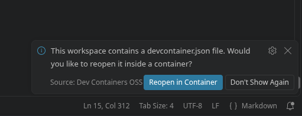

# Lidar-Fill-State-ESP32


## Development in the DevContainer

This project has a dev container setup. With dev container you can build and enter a container that has alle the necessary tools installed for development. To use it you need to have Docker installed and running and the [Dev Container Extension (VScode)](https://marketplace.visualstudio.com/items?itemName=ms-vscode-remote.remote-containers)/[Dev Container OSS Extension (VScodium)](https://open-vsx.org/vscode/item?itemName=s-h-a-d-o-w.dev-containers-oss) installed.

When opening the project afterwards an option to open the enter the devcontainer will be shown:



### Running DevContainer with Podman

Podman can be used as an alternative to docker. For this to work `Dev Container` Extension must be setup to use podman instead of docker (in the Settings). When using `Dev Container OSS` this option doesn't exist. Instead you can create a symbol link in a folder that is in `PATH` (for docker and docker-compose). Afterwards it should work.
Podman can be used as an alternative to docker. For this to work `Dev Container` Extension must be setup to use podman instead of docker (in the Settings). When using `Dev Container OSS` this option doesn't exist. Instead you can create a symbol link in a folder that is in `PATH` (for docker and docker-compose). Afterwards it should work.

### Running DevContainer with VSCode-/VSCodium-Flatpak

Because the flatpak is in a sandbox it cant access local commands and folders directly. The follow steps allow the flatpak to work with DevContainers.

#### Allow proposed Apis (only if VSCodium)

When running VSCodium as a flatpak some apis of VSCodium must be activated for the extension to work (if you're using VSCode you can skip this step):

In the Command Pallet (`ctrl` + `shift` + `P`) run this:

```
Preferences: Configure Runtime Arguments
```

Here add this settings to enable the propsed apis for the `Dev Container OSS` Extension:

```json
  "enable-proposed-api": [
		"s-h-a-d-o-w.dev-containers-oss"
	]
```

#### Install Podman compose (only if Podman)

Podman compose must be installed. If you haven't done that already you can do it in the `Docker Desktop`-App under `Extensions > Compose Extensions`. If you are on a system that has its files readonly, make sure you disable the write protection before and enable it again afterwards.

On the StreamOs it can be done with this command:

```bash
# Disable the write protection for the steamos
sudo steamos-readonly disable

# Install podman compose with Docker Desktop

# Enable the write protection for the steamos
sudo steamos-readonly enable

# Be aware that steamos resets everything that is in folders which 
# are under its write protection, when a major update is done.
# Disabling the readonly doesn't change that.
# That mean that this step likely must be repeated after an update (but only this one).
```

#### Create Symbol-Link for Podman (only if Podman)

When using Podman and the VSCode `Dev Container` Extension the path of the docker executable can be changed in the settings. When using VSCodium and `Dev Container OSS` Extension it can't be changed in the settings. Instead a symbol link must be created so that the extension can call `docker` but is redirected to `podman`. This works because both have the same API.

```bash
ln -s /usr/bin/podman /usr/bin/docker
```

When using the VSCode-/VSCodium-Flatpak this wont work, because of permissions. Instead run this command:

```bash
cat > ~/.local/bin/docker <<'EOF'
#!/bin/sh
exec flatpak-spawn --host /usr/bin/podman "$@"
EOF

chmod +x ~/.local/bin/docker
```

Instead of a symbol link it creates a script that routes the parameters of `docker` to podman outside the sandbox. Since this needs an extra permission an other command is necessary:

```bash
flatpak override --user --talk-name=org.freedesktop.Flatpak com.vscodium.codium
```

Now the dev container can see `podman` (through the symlink). But for flatpaks specificity one problem remains. Since podman is started on the host outside the sandbox it will try to store temp fils in /tmp. But the VSCode/VSCodium-Flatpak doesn't have access to that directory. Instead of granting access to this directory a new can can be created and then flatpak can be told to use this one:

```bash
mkdir -p /home/{USERNAME}/devcontainer-tmp

flatpak override --user --env=TMPDIR=/home/{USERNAME}/devcontainer-tmp com.vscodium.codium
```

After these steps the DevContainer should be able to build.